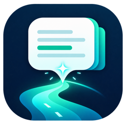
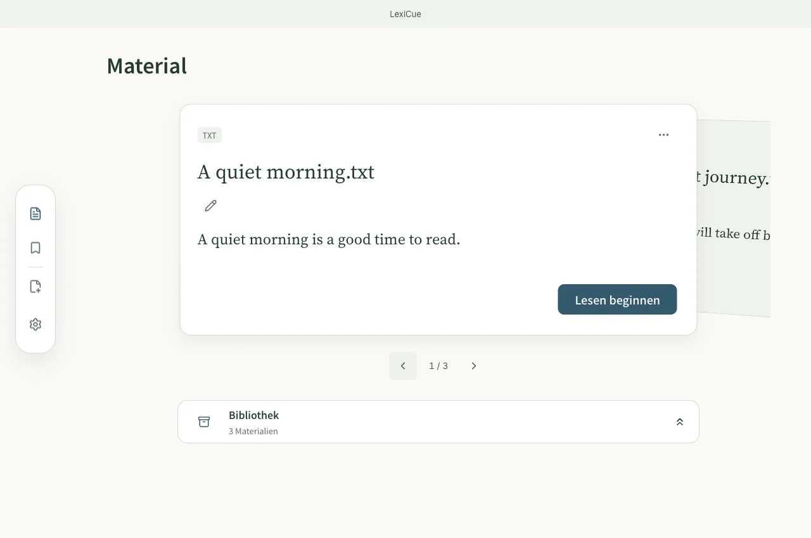
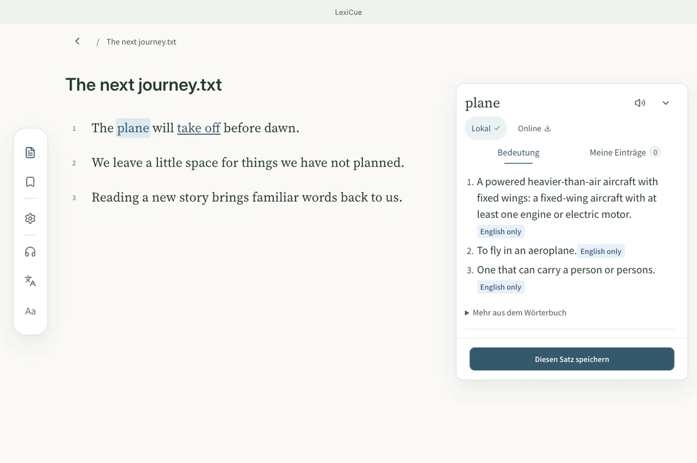
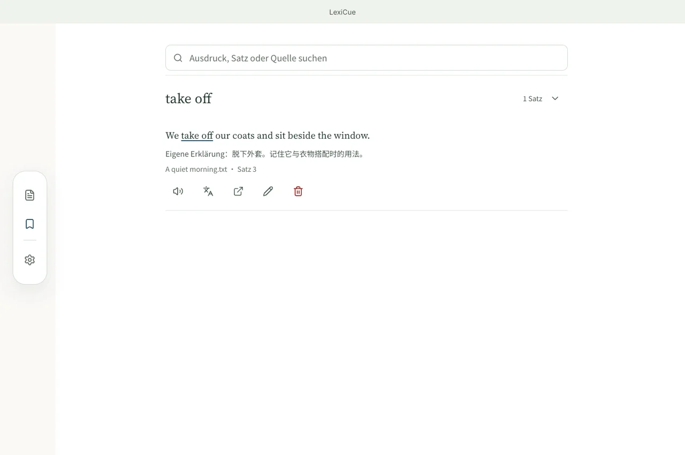
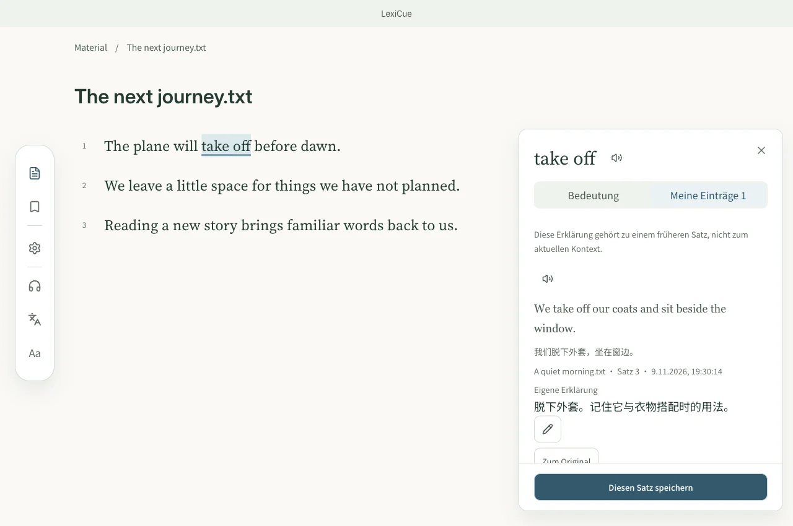

<p align="center"></p>
<h1 align="center">LexiCue</h1>
<p align="center"><strong>Lies, was du liebst. Behalte die Wörter.</strong></p>
<p align="center"><a href="README.md">English</a> · <a href="README.zh-CN.md">简体中文</a> · <a href="README.ja.md">日本語</a> · <a href="README.de.md">Deutsch</a></p>

<p align="center">
  <a href="https://github.com/skylar-deepmind/LexiCue/releases/latest"></a>
  <a href="LICENSE"></a>
  <a href="https://github.com/skylar-deepmind/LexiCue/actions/workflows/ci.yml"></a>
  <a href="https://github.com/skylar-deepmind/LexiCue/releases/latest"></a>
  <a href="https://skylar-deepmind.github.io/LexiCue/de/#feature-languages"></a>
</p>

<p align="center"><a href="https://github.com/skylar-deepmind/LexiCue/releases/latest"><strong>Kostenlos herunterladen</strong></a> · <a href="https://skylar-deepmind.github.io/LexiCue/de/">Arbeitsbereich öffnen</a> · <a href="DISTRIBUTION.md">Installationsanleitung</a></p>

[](https://skylar-deepmind.github.io/LexiCue/de/)

## Englisch mit eigenen Materialien lesen

Bringe englische Artikel, Bücher oder Untertitel mit. Schlage nur nach, wenn du es brauchst, speichere die Bedeutung mit dem Originalsatz und erinnere dich beim nächsten Auftauchen.

> Beschrieben ist der aktuelle main-Zweig. Der öffentliche Download v0.4.5 (12. Oktober 2026) enthält diesen Lesearbeitsplatz und die Mac–iPhone-Synchronisierung noch nicht. Das iPhone wurde mit einem lokal signierten Build geprüft; ein öffentlicher iPhone-Installer fehlt.

## Ein einfacher Lernkreislauf

1. **Importieren** — Wähle englische Inhalte, die dich interessieren.
2. **Verstehen** — Schlage nach, übersetze oder höre bei Bedarf.
3. **Mit Kontext speichern** — Behalte Satz, Bedeutung und eigene Notiz.
4. **Beim Wiedersehen erinnern** — Verbinde neues Lesen mit früheren Begegnungen.

## Den Lernweg ansehen

### Lesen und verstehen

[](https://skylar-deepmind.github.io/LexiCue/de/guide/reading/)

Wähle ein Wort für die Wörterbuchsuche oder eine Passage für ihre Bedeutung. Der Originaltext bleibt sichtbar. Das Offline-Paket Alltag & Allgemeinwissen von Wiktionary ist enthalten (60,69 MB Wörterbuchdaten). Optionale Lektüre- und Fachpakete verwaltest du in den Einstellungen.

### Mit Kontext speichern

[](https://skylar-deepmind.github.io/LexiCue/de/guide/vocabulary/)

Speichere Wörter oder Passagen mit Originalsatz, Satzübersetzung und verfügbarer Wörterbuchreferenz. Ergänze eine eigene Erklärung oder Notiz; die Referenz bestätigt keine Bedeutung für diesen Satz.

### Beim Wiedersehen erinnern

[](https://skylar-deepmind.github.io/LexiCue/de/guide/review/)

Gespeicherte Ausdrücke werden beim späteren Lesen hervorgehoben. Öffne frühere Sätze und Notizen und kehre zu ihrer Quelle zurück.

> README-Screenshots verwenden Beispieldaten. Online werden die aktuellen Desktop- und Mobilansichten mit temporären Demodaten genutzt. Echte Gerätekopplung und native Update-Dienste sind nicht verbunden. Dateien, Zwischenablage und Sprachausgabe nutzen Browserfunktionen und erforderliche Berechtigungen.

## Funktionen

- **[Deine englischen Materialien importieren](https://skylar-deepmind.github.io/LexiCue/de/guide/files/)** — Importiere PDF, DOCX, EPUB, Markdown, TXT, SRT oder VTT. Füge englischen Text, einen Webseiten- oder YouTube-Link ein und prüfe den extrahierten Inhalt vor dem Import.
- **[Beim Lesen Wörter nachschlagen](https://skylar-deepmind.github.io/LexiCue/de/guide/reading/)** — Wähle ein Wort für die Wörterbuchsuche oder eine Passage für ihre Bedeutung. Der Originaltext bleibt sichtbar. Das Offline-Paket Alltag & Allgemeinwissen von Wiktionary ist enthalten (60,69 MB Wörterbuchdaten). Optionale Lektüre- und Fachpakete verwaltest du in den Einstellungen.
- **[Bei Bedarf übersetzen und zuhören](https://skylar-deepmind.github.io/LexiCue/de/guide/reading/)** — Blende chinesische Übersetzungen ein oder aus und starte den Hörmodus. Quellaudio wird verwendet, wenn verfügbar; Sprachausgabe und Übersetzung benötigen die jeweiligen Dienste.
- **[Bedeutung und Kontext zusammen speichern](https://skylar-deepmind.github.io/LexiCue/de/guide/vocabulary/)** — Speichere Wörter oder Passagen mit Originalsatz, Satzübersetzung und verfügbarer Wörterbuchreferenz. Ergänze eine eigene Erklärung oder Notiz; die Referenz bestätigt keine Bedeutung für diesen Satz.
- **[Beim Wiedersehen erinnern](https://skylar-deepmind.github.io/LexiCue/de/guide/review/)** — Gespeicherte Ausdrücke werden beim späteren Lesen hervorgehoben. Öffne frühere Sätze und Notizen und kehre zu ihrer Quelle zurück.
- **[An der letzten Stelle weiterlesen](https://skylar-deepmind.github.io/LexiCue/de/guide/insights/)** — Öffne ein Material an der gespeicherten Leseposition. Von einer gespeicherten Quelle kannst du zur vorherigen Stelle zurückkehren.
- **[Deinen Lesetisch ordnen](https://skylar-deepmind.github.io/LexiCue/de/guide/files/)** — Ordne Materialkarten auf dem Lesetisch, lege andere Materialien in der Bibliothek ab und suche nach Titel oder farbigen Tags.
- **[Vier Oberflächensprachen, fünf Themen](https://skylar-deepmind.github.io/LexiCue/de/guide/settings/)** — Die Lernsprache ist Englisch. Die Oberfläche bietet Englisch, Chinesisch, Japanisch und Deutsch, fünf Themen und einstellbare Schriftgrößen im Lesebereich.
- **[Die Kontrolle über deine Daten behalten](https://skylar-deepmind.github.io/LexiCue/de/guide/faq/)** — Materialien und gespeicherte Kontexte liegen lokal. Exportiere oder stelle Backups in den Einstellungen wieder her; frühere Lernaufzeichnungen bleiben im Verlauf verfügbar.
- **[Zwischen Mac und iPhone weiterlesen](https://skylar-deepmind.github.io/LexiCue/de/guide/settings/)** — Kopple einen Mac und ein iPhone unter Einstellungen → Gerätesynchronisierung. Scanne den zeitlich begrenzten QR-Code und vergleiche den Code auf beiden Geräten. Erreichbare Apps tauschen Materialien, Kontexte, Notizen, Tags und Lesepositionen im lokalen Netzwerk aus.

## Download und Installation

Öffentliche v0.4.5-Pakete gibt es für macOS, Windows und Android. Der neuere Lesearbeitsbereich steht online und im aktuellen Quellcode bereit; zur Installation ist ein neuerer Release oder eigener Build nötig.

[**Kostenlos herunterladen — macOS / Windows / Android**](https://github.com/skylar-deepmind/LexiCue/releases/latest)

Lies vor der Installation die Release-Hinweise und die Plattformanleitung. Ein öffentliches iPhone-Paket wird noch nicht angeboten. [Installationsanleitung](DISTRIBUTION.md).


## Datenschutz und optionale Verbindungen

Materialien, gespeicherte Kontexte und lokale Wörterbücher bleiben auf deinem Gerät. Webseiten- und YouTube-Import, Online-Wörterbücher, Übersetzung und Sprachausgabe können Netzwerkzugriffe auslösen. Optionale Cloud-Dienste erhalten den für die Aktion benötigten Text. Die Mac–iPhone-Synchronisierung überträgt Lerndaten direkt im lokalen Netzwerk; Originalmedien und Geräteeinstellungen bleiben jeweils vor Ort.

## Projekt unterstützen

[Autor unterstützen — Patreon](https://www.patreon.com/16942122/join) · [爱发电 / Aifadian](https://www.ifdian.net/a/skylar-lexicue) · [GitHub Star](https://github.com/skylar-deepmind/LexiCue)

## Entwicklung

Node.js 22.12+ · Rust · CMake 3.22+ · C++17.

```sh
npm ci
npm run tauri dev
npm run build
npm test
cd src-tauri && cargo test
```

[Marketing / README / Website / Video](marketing/README.md)

## Lizenz

[MIT](LICENSE) · [Third-party notices](THIRD-PARTY-NOTICES.md) · [Dictionary packs](DICTIONARY_PACK.md)
