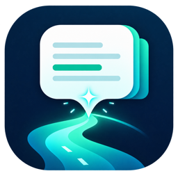
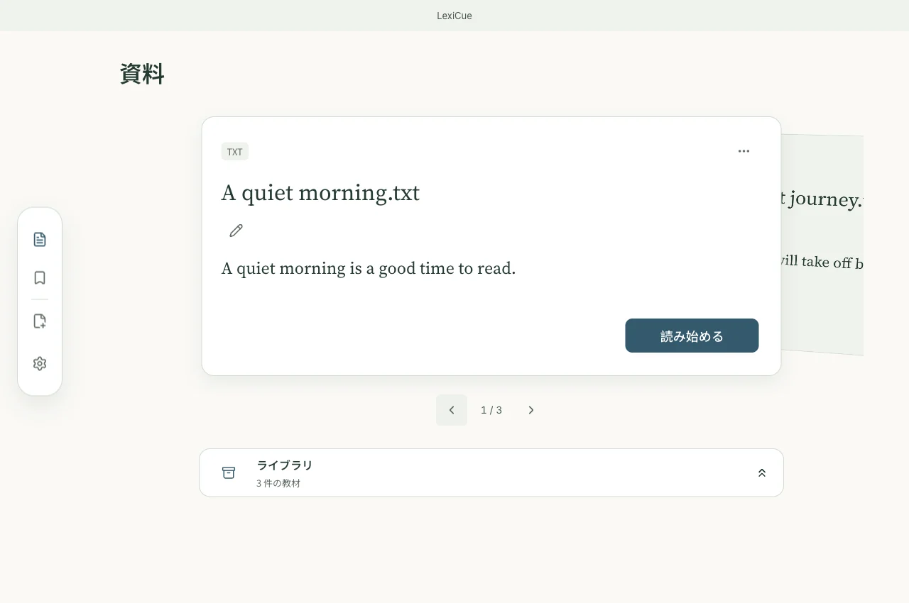
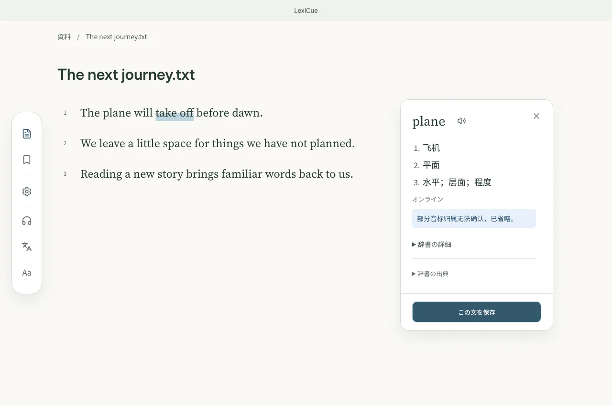
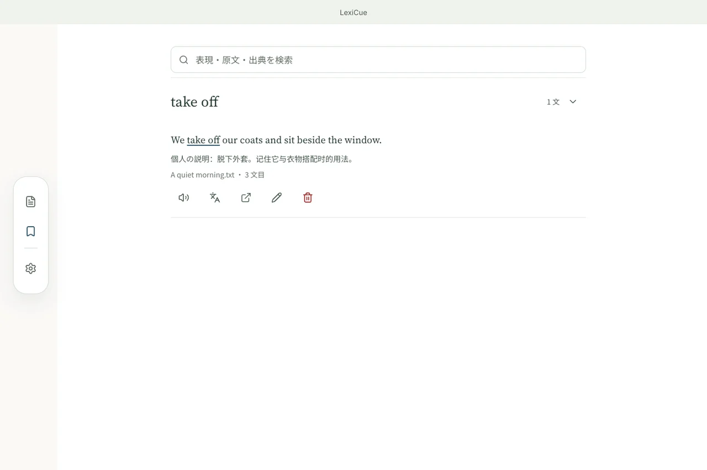
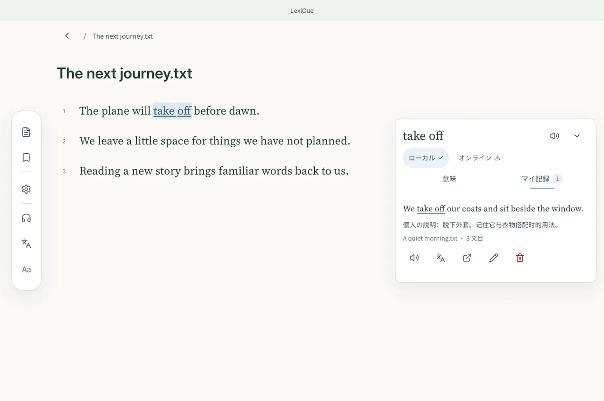

<p align="center"></p>
<h1 align="center">LexiCue</h1>
<p align="center"><strong>好きなものを読んで、使える言葉を覚える。</strong></p>
<p align="center"><a href="README.md">English</a> · <a href="README.zh-CN.md">简体中文</a> · <a href="README.ja.md">日本語</a> · <a href="README.de.md">Deutsch</a></p>

<p align="center">
  <a href="https://github.com/skylar-deepmind/LexiCue/releases/latest"></a>
  <a href="LICENSE"></a>
  <a href="https://github.com/skylar-deepmind/LexiCue/actions/workflows/ci.yml"></a>
  <a href="https://github.com/skylar-deepmind/LexiCue/releases/latest"></a>
  <a href="https://skylar-deepmind.github.io/LexiCue/ja/#feature-languages"></a>
</p>

<p align="center"><a href="https://github.com/skylar-deepmind/LexiCue/releases/latest"><strong>無料でダウンロード</strong></a> · <a href="https://skylar-deepmind.github.io/LexiCue/ja/">使い方を見る</a> · <a href="DISTRIBUTION.md">インストールガイド</a></p>

[](https://skylar-deepmind.github.io/LexiCue/ja/#feature-import)

## 自分の素材で英語を読む

読みたい英語の記事、本、字幕を取り込みます。分からない語句だけを調べ、元の文と一緒に保存。次に出会ったときに、前の文脈を思い出せます。

> ここでは現在の main ブランチの機能を紹介しています。公開ダウンロードは v0.4.5（2026年10月12日）で、この読書ワークスペースと Mac–iPhone 同期は含まれません。iPhone はローカル署名ビルドで実機確認済みですが、公開インストーラーはありません。

## シンプルな学習の流れ

1. **取り込む** — 読みたい英語の素材を用意。
2. **必要なときに調べる** — 単語検索・翻訳・聴読を必要に応じて。
3. **文脈を保存** — 元の文、意味、自分のメモを残す。
4. **再会して思い出す** — 新しい読書から、以前の出会いへ。

## 学習の流れを見る

### 読書と理解

[](https://skylar-deepmind.github.io/LexiCue/ja/guide/reading/)

単語を選んで辞書を引くか、文章の一部を選んで意味を確認。原文を見ながら読めます。

### 文脈を保存

[](https://skylar-deepmind.github.io/LexiCue/ja/guide/vocabulary/)

単語や表現とともに、元の文、文の訳、利用可能な辞書の参照を保存します。自分の説明やメモを添えられます。辞書の参照は、この文の意味を確定するものではありません。

### 再会して思い出す

[](https://skylar-deepmind.github.io/LexiCue/ja/guide/review/)

保存済みの表現が後の読書で強調表示されます。以前の文とメモを開き、元の素材に戻れます。

> 画面は現在の main ブランチとサンプルデータです。個人のライブラリや実際の端末同期には接続しません。

## 主な機能

- **[自分の英語素材を取り込む](https://skylar-deepmind.github.io/LexiCue/ja/#feature-import)** — PDF、DOCX、EPUB、Markdown、TXT、SRT、VTTに対応。英語の本文、WebページやYouTubeのリンクも貼り付け、抽出内容を確認して取り込めます。
- **[読みながら単語を調べる](https://skylar-deepmind.github.io/LexiCue/ja/#feature-lookup)** — 単語を選んで辞書を引くか、文章の一部を選んで意味を確認。原文を見ながら読めます。
- **[必要なときに翻訳・聴読する](https://skylar-deepmind.github.io/LexiCue/ja/#feature-phrases)** — 中国語訳の表示を切り替え、聴読モードに入れます。元の音声があれば再生でき、読み上げと翻訳には対応サービスが必要です。
- **[意味を文脈と一緒に保存する](https://skylar-deepmind.github.io/LexiCue/ja/#feature-collect)** — 単語や表現とともに、元の文、文の訳、利用可能な辞書の参照を保存します。自分の説明やメモを添えられます。辞書の参照は、この文の意味を確定するものではありません。
- **[また出会ったときに思い出す](https://skylar-deepmind.github.io/LexiCue/ja/#feature-review)** — 保存済みの表現が後の読書で強調表示されます。以前の文とメモを開き、元の素材に戻れます。
- **[前回の位置から読み続ける](https://skylar-deepmind.github.io/LexiCue/ja/#feature-progress)** — 素材を開き直すと、保存した読書位置に戻ります。保存した出典から元の画面へも戻れます。
- **[読む素材を整理する](https://skylar-deepmind.github.io/LexiCue/ja/#feature-baseline)** — デスクに素材カードを置き、後で読む素材はライブラリへ。タイトルや色付きタグで探せます。
- **[4つの表示言語と5つのテーマ](https://skylar-deepmind.github.io/LexiCue/ja/#feature-languages)** — 学習対象は英語です。表示言語は英語・中国語・日本語・ドイツ語。5つのテーマと読書画面の文字サイズを選べます。
- **[データを自分の手元に](https://skylar-deepmind.github.io/LexiCue/ja/#feature-privacy)** — 素材と保存した文脈は端末内に保管。設定からバックアップを入出力でき、以前の学習記録は履歴に残ります。
- **[Mac と iPhone で続きを](https://skylar-deepmind.github.io/LexiCue/ja/#feature-sync)** — 設定の「デバイス同期」で Mac 1台と iPhone 1台をペアリング。期限付きQRコードを読み取り、両端末でコードを照合します。接続可能な間、素材・文脈・メモ・タグ・読書位置をローカルネットワークで交換します。

## ダウンロードとインストール

公開版 v0.4.5 は macOS・Windows・Android向けです。上記機能は main に統合済みで、今後のリリースまたはソースからのビルドが必要です。

[**無料でダウンロード — macOS / Windows / Android**](https://github.com/skylar-deepmind/LexiCue/releases/latest)

導入前にリリースノートと環境別のインストール案内を確認してください。公開 iPhone パッケージはありません。 [インストールガイド](DISTRIBUTION.md).


## プライバシーと任意の接続

素材、保存した文脈、ローカル辞書は端末に残ります。WebページやYouTubeの取得、オンライン辞書、翻訳、読み上げは通信する場合があります。任意のクラウドサービスには、その操作に必要な文章が送られます。Mac–iPhone 同期はローカルネットワークで資料を直接交換し、元のメディアと端末設定は各端末に残ります。

## プロジェクトを支援

[作者を支援 — Patreon](https://www.patreon.com/16942122/join) · [爱发电 / Aifadian](https://www.ifdian.net/a/skylar-lexicue) · [GitHub Star](https://github.com/skylar-deepmind/LexiCue)

## 開発

Node.js 22.12+ · Rust · CMake 3.22+ · C++17.

```sh
npm ci
npm run tauri dev
npm run build
npm test
cd src-tauri && cargo test
```

[Marketing / README / Website / Video](marketing/README.md)

## ライセンス

[MIT](LICENSE) · [Third-party notices](THIRD-PARTY-NOTICES.md) · [Dictionary packs](DICTIONARY_PACK.md)
