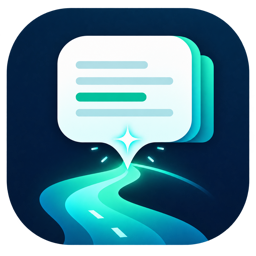
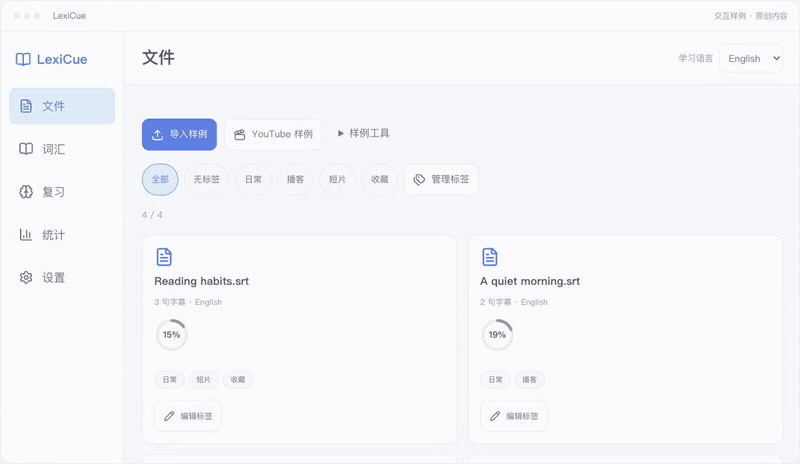
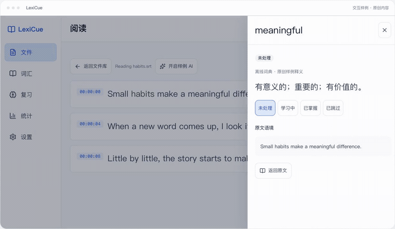
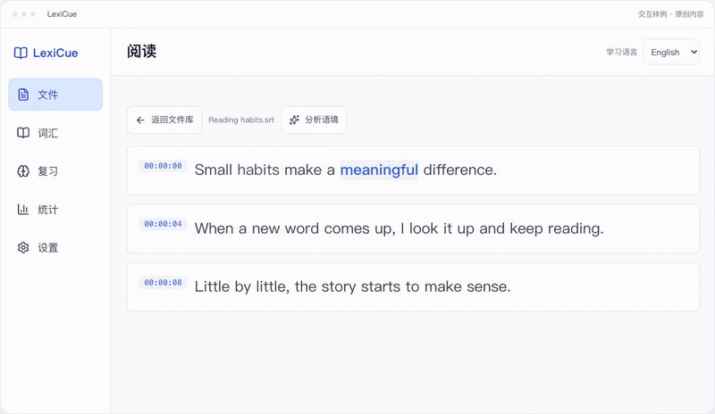
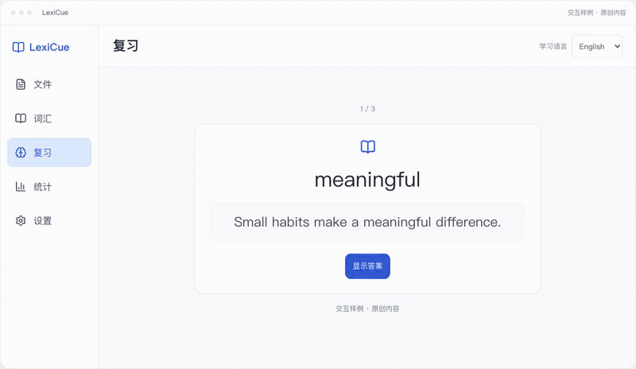

<p align="center"></p>
<h1 align="center">LexiCue</h1>
<p align="center"><strong>好きなものを読んで、使える言葉を覚える。</strong></p>
<p align="center"><a href="README.md">English</a> · <a href="README.zh-CN.md">简体中文</a> · <a href="README.ja.md">日本語</a> · <a href="README.de.md">Deutsch</a></p>

<p align="center">
  <a href="https://github.com/skylar-deepmind/LexiCue/releases/latest"></a>
  <a href="LICENSE"></a>
  <a href="https://github.com/skylar-deepmind/LexiCue/actions/workflows/ci.yml"></a>
  <a href="https://github.com/skylar-deepmind/LexiCue/releases/latest"></a>
  <a href="https://skylar-deepmind.github.io/LexiCue/ja/#feature-languages"></a>
</p>

<p align="center"><a href="https://github.com/skylar-deepmind/LexiCue/releases/latest"><strong>無料でダウンロード</strong></a> · <a href="https://skylar-deepmind.github.io/LexiCue/ja/">使い方を見る</a> · <a href="DISTRIBUTION.md">インストールガイド</a></p>

[](https://skylar-deepmind.github.io/LexiCue/ja/#feature-import)

## 自分の素材で言語を学ぶ

好きなSRT字幕を取り込みましょう。元の文で単語を調べて蓄積し、復習で記憶に残します。

## シンプルな学習の流れ

1. **取り込む** — 好きな素材を取り込む。
2. **読んで理解** — 文脈で単語を調べる。
3. **蓄積** — 単語とフレーズを整理。
4. **復習** — 間隔反復で復習する。

## 学習の流れを見る

### 読書と単語検索

[](https://skylar-deepmind.github.io/LexiCue/ja/#feature-lookup)

文中の単語をタップして意味を確認。内蔵のオフライン辞書で読書を続けられます。

### 文脈とフレーズ

[](https://skylar-deepmind.github.io/LexiCue/ja/#feature-phrases)

任意のAIで英語の表現と文中の用法を分析。Gemmaはモデルを別途取得してローカルで動作します。

### 元の文で復習

[](https://skylar-deepmind.github.io/LexiCue/ja/#feature-review)

元の文と一緒に単語やフレーズを復習。回答に応じて次の復習が決まります。

> 実際のコンポーネントとオリジナルのサンプルを使用。AI結果は固定例で、同期は仕組みの説明です。

## 主な機能

- **[好きな素材から学ぶ](https://skylar-deepmind.github.io/LexiCue/ja/#feature-import)** — SRT字幕を取り込み、内容と学習言語を確認できます。YouTubeから字幕を取得する入口もあります。
- **[読む流れを止めずに調べる](https://skylar-deepmind.github.io/LexiCue/ja/#feature-lookup)** — 文中の単語をタップして意味を確認。内蔵のオフライン辞書で読書を続けられます。
- **[表現を文脈で理解する](https://skylar-deepmind.github.io/LexiCue/ja/#feature-phrases)** — 任意のAIで英語の表現と文中の用法を分析。Gemmaはモデルを別途取得してローカルで動作します。
- **[元の文章につながる語彙](https://skylar-deepmind.github.io/LexiCue/ja/#feature-collect)** — 絞り込み、タグ、学習状態で整理。一括または一つずつ注釈し、元の文に戻れます。
- **[ちょうどよい時に、もう一度](https://skylar-deepmind.github.io/LexiCue/ja/#feature-review)** — 元の文と一緒に単語やフレーズを復習。回答に応じて次の復習が決まります。
- **[学びの進み具合が見える](https://skylar-deepmind.github.io/LexiCue/ja/#feature-progress)** — 語彙の状態、7日間の復習、ファイルの学習指数を確認できます。
- **[知っている単語から始める](https://skylar-deepmind.github.io/LexiCue/ja/#feature-baseline)** — 英語・中国語の頻出上位1,000〜10,000語を既知語に設定し、復習で少しずつ確認。
- **[4言語、自分らしい読み方](https://skylar-deepmind.github.io/LexiCue/ja/#feature-languages)** — 英語、日本語、ドイツ語、中国語。かな、ピンイン、語形処理に対応し、明るいテーマとmidnightを選べます。
- **[学習データは自分の手元に](https://skylar-deepmind.github.io/LexiCue/ja/#feature-privacy)** — 記録は端末内に保存。バックアップの書き出しと復元ができ、ローカル学習にアカウントは不要です。
- **[別のデバイスでも続きを](https://skylar-deepmind.github.io/LexiCue/ja/#feature-sync)** — 任意のエンドツーエンド暗号化同期でPCとスマートフォンを接続。アニメーションは仕組みの説明です。

## ダウンロードとインストール

macOS、Windows、Android対応。アプリをインストールして、好きな素材から始めましょう。

[**無料でダウンロード — macOS / Windows / Android**](https://github.com/skylar-deepmind/LexiCue/releases/latest)

インストーラーは未署名です。初回起動はインストールガイドを参照。Gemmaモデルは別途取得します。 [インストールガイド](DISTRIBUTION.md).

Gemma: [E2B / E4B](docs/embedded-gemma.md).

## プライバシーと任意の接続

読書・辞書・復習はローカルで動作。YouTube字幕やAIモデルの取得には通信が必要です。任意のクラウドAIは選択した文章を設定済みAPIへ送り、同期では暗号化した記録をアップロードします。

## プロジェクトを支援

[作者を支援 — Patreon](https://www.patreon.com/16942122/join) · [爱发电 / Aifadian](https://www.ifdian.net/a/skylar-lexicue) · [GitHub Star](https://github.com/skylar-deepmind/LexiCue)

## 開発

Node.js 22.12+ · Rust · CMake 3.22+ · C++17. [Gemma](docs/embedded-gemma.md).

```sh
npm install
npm run tauri dev
npm run build
npm test
cd src-tauri && cargo test
```

[Marketing / README / Website / Video](marketing/README.md)

## ライセンス

[MIT](LICENSE) · [Third-party notices](THIRD-PARTY-NOTICES.md) · [Dictionary packs](DICTIONARY_PACK.md)
