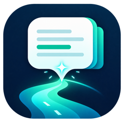
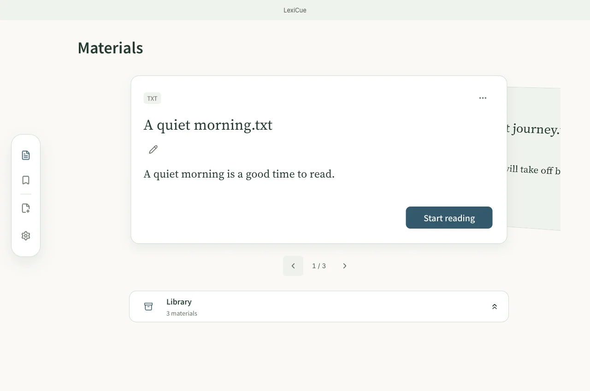
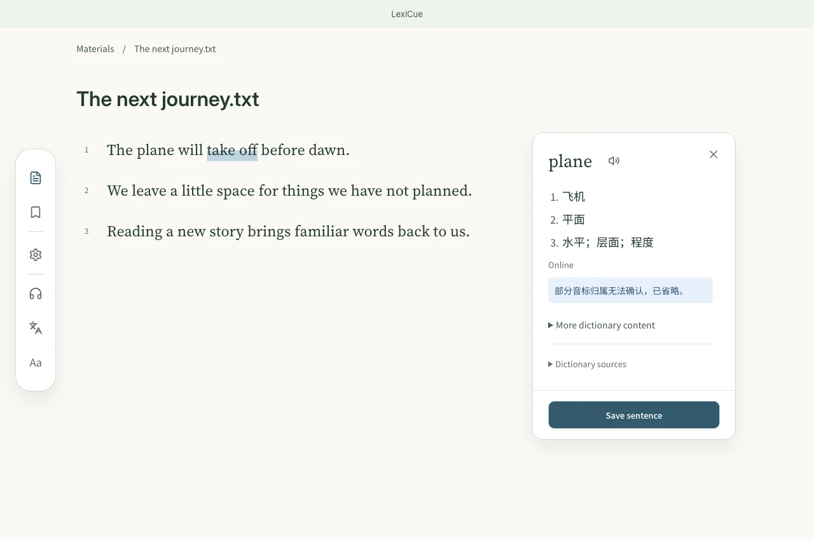
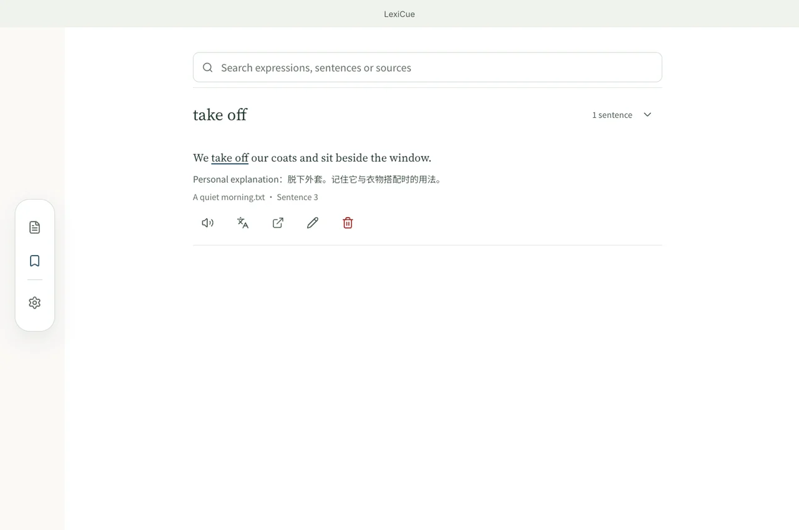
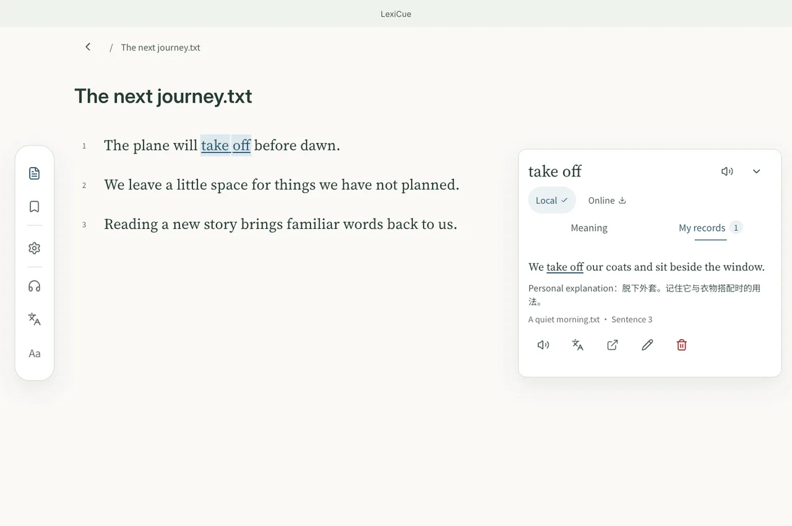

<p align="center"></p>
<h1 align="center">LexiCue</h1>
<p align="center"><strong>Read what you love. Remember the words.</strong></p>
<p align="center"><a href="README.md">English</a> · <a href="README.zh-CN.md">简体中文</a> · <a href="README.ja.md">日本語</a> · <a href="README.de.md">Deutsch</a></p>

<p align="center">
  <a href="https://github.com/skylar-deepmind/LexiCue/releases/latest"></a>
  <a href="LICENSE"></a>
  <a href="https://github.com/skylar-deepmind/LexiCue/actions/workflows/ci.yml"></a>
  <a href="https://github.com/skylar-deepmind/LexiCue/releases/latest"></a>
  <a href="https://skylar-deepmind.github.io/LexiCue/#feature-languages"></a>
</p>

<p align="center"><a href="https://github.com/skylar-deepmind/LexiCue/releases/latest"><strong>Download free</strong></a> · <a href="https://skylar-deepmind.github.io/LexiCue/">See it in action</a> · <a href="DISTRIBUTION.md">Installation guide</a></p>

[](https://skylar-deepmind.github.io/LexiCue/#feature-import)

## Learn English from your own materials

Bring English articles, books or subtitles. Understand a word or passage when you need it, save it with its original context, and recall it when it appears again.

> Current main-branch features are described here. The latest public download is v0.4.5 (12 October 2026), which predates this reading workspace and Mac–iPhone sync. iPhone has been tested with a locally signed build; no public iPhone installer is available.

## A simple learning loop

1. **Import** — Choose English material you want to read.
2. **Understand** — Look up or translate only when needed.
3. **Save with context** — Keep the sentence, meaning and your note.
4. **Recall on re-encounter** — Reconnect today’s reading with earlier encounters.

## See the workflow

### Read and understand

[](https://skylar-deepmind.github.io/LexiCue/guide/reading/)

Select a word for dictionary lookup, or select a passage for its meaning. Read the definition beside the original text.

### Save with context

[](https://skylar-deepmind.github.io/LexiCue/guide/vocabulary/)

Save words or passages with their original sentence, its translation and the available dictionary reference. Add your own explanation or note; a dictionary reference does not confirm the meaning in this sentence.

### Recall on re-encounter

[](https://skylar-deepmind.github.io/LexiCue/guide/review/)

Previously saved expressions are highlighted in later reading. Open the earlier sentences and notes, then return to their sources.

> Screenshots show the current main-branch interface with sample data. They do not access your library or demonstrate live device sync.

## Features

- **[Bring your English materials](https://skylar-deepmind.github.io/LexiCue/#feature-import)** — Import PDF, DOCX, EPUB, Markdown, TXT, SRT or VTT. Paste English text, a webpage link or a YouTube link, then check the extracted content before importing.
- **[Look up words as you read](https://skylar-deepmind.github.io/LexiCue/#feature-lookup)** — Select a word for dictionary lookup, or select a passage for its meaning. Read the definition beside the original text.
- **[Understand a passage when you need it](https://skylar-deepmind.github.io/LexiCue/#feature-phrases)** — Show or hide Chinese translations and enter listening mode. Source playback is used when available; speech and missing translations need their online services.
- **[Save the meaning and its context](https://skylar-deepmind.github.io/LexiCue/#feature-collect)** — Save words or passages with their original sentence, its translation and the available dictionary reference. Add your own explanation or note; a dictionary reference does not confirm the meaning in this sentence.
- **[Recall it when you meet it again](https://skylar-deepmind.github.io/LexiCue/#feature-review)** — Previously saved expressions are highlighted in later reading. Open the earlier sentences and notes, then return to their sources.
- **[Pick up where you left off](https://skylar-deepmind.github.io/LexiCue/#feature-progress)** — Reopen a material at its saved reading position. Open a saved source and return to the place you came from.
- **[Keep your reading desk in order](https://skylar-deepmind.github.io/LexiCue/#feature-baseline)** — Arrange material cards on your desk, put materials away in the library, and find them by title or colored tags.
- **[Four interface languages, five themes](https://skylar-deepmind.github.io/LexiCue/#feature-languages)** — Learn English with an English, Chinese, Japanese or German interface. Choose ocean, sage, amber, twilight or midnight, and adjust text size in the reader.
- **[Keep control of your data](https://skylar-deepmind.github.io/LexiCue/#feature-privacy)** — Materials and saved contexts live locally. Export or restore a backup in Settings; older learning records remain available in History.
- **[Continue between Mac and iPhone](https://skylar-deepmind.github.io/LexiCue/#feature-sync)** — Pair one Mac and one iPhone in Settings → Device sync. Scan the temporary QR code and compare the code on both devices. Reachable paired apps exchange materials, saved contexts, notes, tags and reading positions on the local network.

## Download & install

Public downloads: v0.4.5 for macOS, Windows and Android. The features shown above are in main and will require a newer release or a source build.

[**Download free — macOS / Windows / Android**](https://github.com/skylar-deepmind/LexiCue/releases/latest)

Check the release notes and platform installation guide before installing. No public iPhone package is offered. [Installation guide](DISTRIBUTION.md).


## Privacy & optional connections

Materials, saved contexts and local dictionary data stay on your device. Webpage and YouTube imports, online dictionaries, translation and speech may make network requests. Optional cloud services receive the text needed for that action. Mac–iPhone sync transfers learning records directly over the local network; original media and device preferences stay on each device.

## Support the project

[Support the author — Patreon](https://www.patreon.com/16942122/join) · [爱发电 / Aifadian](https://www.ifdian.net/a/skylar-lexicue) · [GitHub Star](https://github.com/skylar-deepmind/LexiCue)

## Development

Node.js 22.12+ · Rust · CMake 3.22+ · C++17.

```sh
npm ci
npm run tauri dev
npm run build
npm test
cd src-tauri && cargo test
```

[Marketing / README / Website / Video](marketing/README.md)

## License

[MIT](LICENSE) · [Third-party notices](THIRD-PARTY-NOTICES.md) · [Dictionary packs](DICTIONARY_PACK.md)
