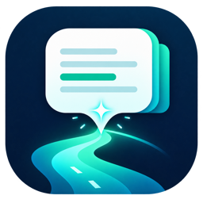
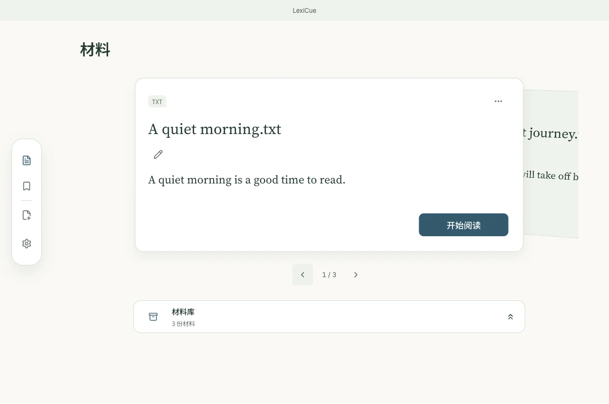
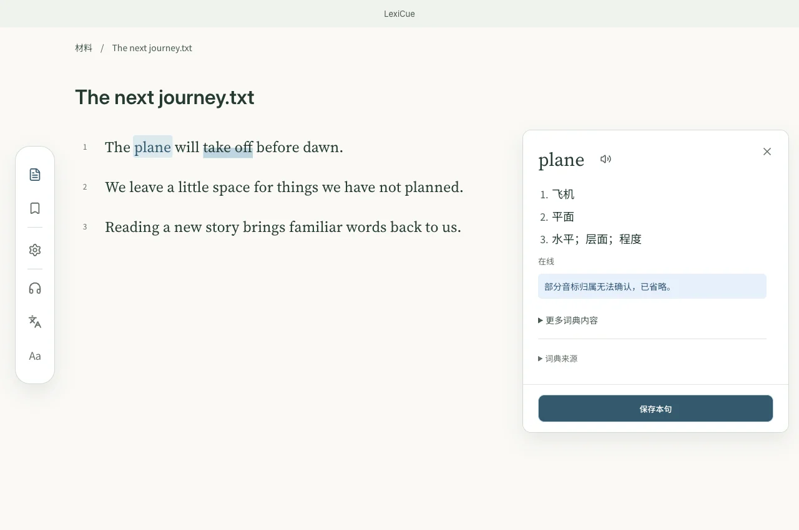
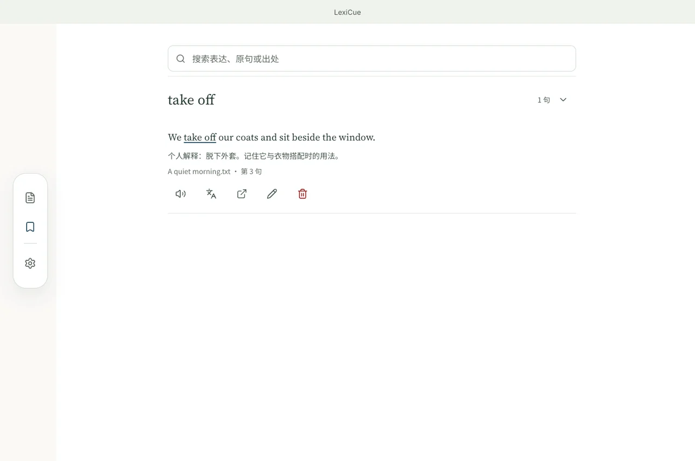
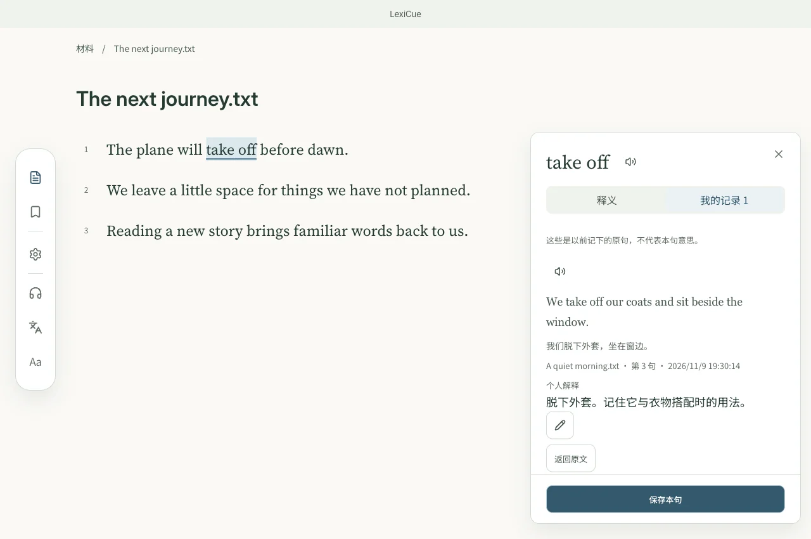

<p align="center"></p>
<h1 align="center">LexiCue</h1>
<p align="center"><strong>读你喜欢的内容，记住真正会用的词。</strong></p>
<p align="center"><a href="README.md">English</a> · <a href="README.zh-CN.md">简体中文</a> · <a href="README.ja.md">日本語</a> · <a href="README.de.md">Deutsch</a></p>

<p align="center">
  <a href="https://github.com/skylar-deepmind/LexiCue/releases/latest"></a>
  <a href="LICENSE"></a>
  <a href="https://github.com/skylar-deepmind/LexiCue/actions/workflows/ci.yml"></a>
  <a href="https://github.com/skylar-deepmind/LexiCue/releases/latest"></a>
  <a href="https://skylar-deepmind.github.io/LexiCue/zh/#feature-languages"></a>
</p>

<p align="center"><a href="https://github.com/skylar-deepmind/LexiCue/releases/latest"><strong>免费下载</strong></a> · <a href="https://skylar-deepmind.github.io/LexiCue/zh/">打开工作区</a> · <a href="DISTRIBUTION.md">安装指南</a></p>

[](https://skylar-deepmind.github.io/LexiCue/zh/)

## 用自己的材料读英语

带来想读的英文文章、书籍或字幕。遇到不懂的词句再查，连同原句与理解一起保存，在下次遇见时唤回记忆。

> v0.4.7 正在准备，尚未公开发布。本文介绍当前 main 分支的功能。最新公开下载仍为 v0.4.5（2026 年 10 月 12 日），早于本次阅读工作区和 Mac–iPhone 同步。iPhone 已通过本地签名构建实测，尚无公开安装包。

## 简单的学习闭环

1. **导入材料** — 带来自己想读的英文内容。
2. **按需理解** — 需要时查词、看译文或听读。
3. **保存语境** — 留下原句、释义和自己的注释。
4. **重遇回顾** — 让今天的阅读唤起过去的相遇。

## 看看实际学习流程

### 阅读与理解

[](https://skylar-deepmind.github.io/LexiCue/zh/guide/reading/)

点选单词查词，或选择一段表达查看含义；释义与原文同时可见。 内置离线 Wiktionary「日常通识」包，词典数据约 60.69 MB；可在设置中管理「进阶阅读」和「专业参考」扩展包。

### 保存语境

[](https://skylar-deepmind.github.io/LexiCue/zh/guide/vocabulary/)

保存单词或一段表达，同时保留原句、句子译文与可用的词典参考。可填写自己的解释或注释；词典参考不等于确认本句含义。

### 重遇回顾

[](https://skylar-deepmind.github.io/LexiCue/zh/guide/review/)

收藏过的表达会在后续阅读中高亮。打开过去的原句和注释，随时返回当时的材料。

> README 截图使用样例数据。在线工作区复用当前桌面与手机版界面，使用临时演示数据。不连接真实设备配对与原生更新服务；文件、剪贴板和朗读使用浏览器能力及相应授权。

## 特色功能

- **[带来自己的英文材料](https://skylar-deepmind.github.io/LexiCue/zh/guide/files/)** — 支持 PDF、DOCX、EPUB、Markdown、TXT、SRT、VTT，也可粘贴英文正文、网页链接或 YouTube 链接，检查提取的内容后导入。
- **[读到不懂的词，随手查](https://skylar-deepmind.github.io/LexiCue/zh/guide/reading/)** — 点选单词查词，或选择一段表达查看含义；释义与原文同时可见。 内置离线 Wiktionary「日常通识」包，词典数据约 60.69 MB；可在设置中管理「进阶阅读」和「专业参考」扩展包。
- **[需要时再翻译与听读](https://skylar-deepmind.github.io/LexiCue/zh/guide/reading/)** — 按需显示或隐藏中文译文，进入听读模式；有来源音频时可播放来源。朗读和翻译需相应服务可用。
- **[把理解连同语境一起保存](https://skylar-deepmind.github.io/LexiCue/zh/guide/vocabulary/)** — 保存单词或一段表达，同时保留原句、句子译文与可用的词典参考。可填写自己的解释或注释；词典参考不等于确认本句含义。
- **[下次遇见，想起上一次](https://skylar-deepmind.github.io/LexiCue/zh/guide/review/)** — 收藏过的表达会在后续阅读中高亮。打开过去的原句和注释，随时返回当时的材料。
- **[从上次读到的地方继续](https://skylar-deepmind.github.io/LexiCue/zh/guide/insights/)** — 再次打开材料时接着读。从设置或收藏来源返回时，保留搜索、页码、滚动位置、展开例句和查词状态。
- **[整理自己的阅读桌面](https://skylar-deepmind.github.io/LexiCue/zh/guide/files/)** — 桌面只摆正在读的材料；完整材料库支持搜索、标签、排序和分页。已保存词条及例句分别分页。删除材料仍保留已保存的原句、释义和笔记。
- **[四种界面语言，五种主题](https://skylar-deepmind.github.io/LexiCue/zh/guide/settings/)** — 学习目标为英语；界面可选中文、英语、日语、德语，支持海湾蓝、鼠尾草绿、琥珀暖光、暮光紫、深夜墨色五种主题，阅读中可调字号。
- **[学习资料留在自己手里](https://skylar-deepmind.github.io/LexiCue/zh/guide/faq/)** — 材料与语境收藏保存在本地，可在设置中导出与恢复备份；旧学习记录保留在“历史记录”中。
- **[在 Mac 与 iPhone 之间接续](https://skylar-deepmind.github.io/LexiCue/zh/guide/settings/)** — 在“设置 → 设备同步”中配对一台 Mac 和一台 iPhone：扫描临时二维码，在两端核对验证码。连接可达时，材料、语境收藏、注释、标签和阅读位置通过局域网交换。

## 下载与安装

公开 v0.4.5 提供 macOS、Windows 与 Android 安装包。较新的阅读工作区可在线体验，也已包含在当前源码中；本地安装需要后续版本或自行构建。

[**免费下载 — macOS / Windows / Android**](https://github.com/skylar-deepmind/LexiCue/releases/latest)

安装前请查看版本说明和对应平台的安装指南。暂不提供公开 iPhone 安装包。 [安装指南](DISTRIBUTION.md).


## 隐私与可选联网

材料、语境收藏与本地词典数据保存在设备上。网页与 YouTube 导入、在线词典、翻译和朗读可能发起联网请求；可选云服务会接收本次操作所需的文本。Mac–iPhone 同步通过局域网直接交换学习资料，媒体原件与设备偏好各自留机。

## 支持项目

[爱发电 / Aifadian](https://www.ifdian.net/a/skylar-lexicue) · [GitHub Star](https://github.com/skylar-deepmind/LexiCue)

## 开发

Node.js 22.12+ · Rust · CMake 3.22+ · C++17.

```sh
npm ci
npm run tauri dev
npm run build
npm test
cd src-tauri && cargo test
```

[Marketing / README / Website / Video](marketing/README.md)

## 许可证

[MIT](LICENSE) · [Third-party notices](THIRD-PARTY-NOTICES.md) · [Dictionary packs](DICTIONARY_PACK.md)
